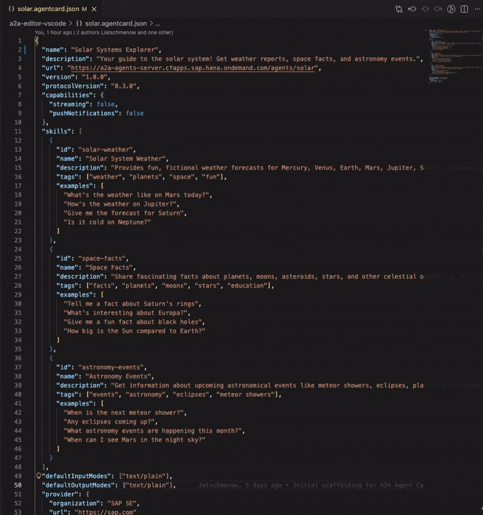

[](https://marketplace.visualstudio.com/items?itemName=open-resource-discovery.a2a-editor-vscode) [](https://marketplace.visualstudio.com/items?itemName=open-resource-discovery.a2a-editor-vscode) [](LICENSE)

# A2A Editor for VSCode

Visual editor for [A2A (Agent-to-Agent)](https://a2a-protocol.org) protocol Agent Cards inside VS Code, with built-in agent discovery through [Open Resource Discovery (ORD)](https://open-resource-discovery.org). Discover, browse, edit, validate, and test your agents without leaving your IDE.

Built on [@open-resource-discovery/a2a-editor](https://github.com/open-resource-discovery/a2a-editor).

## Features

- **Activity Bar Sidebar** — Dedicated A2A icon in the sidebar with auto-detection of agent card files in the active editor
- **Custom Editor** — Open `*.agentcard.json`, `agent-card.json`, or `agent.json` files as rendered, interactive agent cards
- **Agent Overview** — View agent name, version, provider, description, capabilities, skills, and security schemes at a glance
- **Chat & Testing** — Send messages to connected A2A agents and inspect raw HTTP request/response payloads
- **ORD Discovery** — List every A2A agent an [Open Resource Discovery (ORD)](https://open-resource-discovery.org) provider publishes and load one with a click ([details](#ord-discovery))
- **URL Discovery** — Connect to agents via URL with automatic well-known path resolution
- **Authentication** — Built-in support for Basic Auth, Bearer Token, and API Key authentication
- **Theme Integration** — Seamlessly follows VS Code light, dark, and high-contrast themes

## Quick Start

1. Install **A2A Editor** from the [VS Marketplace](https://marketplace.visualstudio.com/items?itemName=open-resource-discovery.a2a-editor-vscode) — either:
   - In VS Code: open the **Extensions** view, search for `A2A Editor`, and click **Install**.
   - From the command line:
     ```bash
     code --install-extension open-resource-discovery.a2a-editor-vscode
     ```
2. Click the **A2A icon** in the Activity Bar (left sidebar)
3. Enter an agent URL and click **Connect**, discover agents from an [ORD](#ord-discovery) endpoint, or open any agent card JSON file

## Usage

### Sidebar

The sidebar provides a persistent view for browsing agent cards. It automatically detects when the active editor contains an agent card JSON file and switches to display it. Use **Source Type** to choose where the agent card comes from:

- **URL** — connect to a remote agent by URL
- **ORD** — discover agents from an [Open Resource Discovery](#ord-discovery) provider and pick one
- **Current File** — show the agent card file open in the editor


### Custom Editor

Open any agent card file, then run `Cmd+Shift+P` (macOS) / `Ctrl+Shift+P` (Windows/Linux) → **"A2A: Open Current File as Agent Card"** to open it as a visual agent card. Changes sync bidirectionally between the visual editor and the underlying JSON file.



## Commands

| Command                                | Description                                        |
| -------------------------------------- | -------------------------------------------------- |
| `A2A: Open Current File as Agent Card` | Open the active JSON file in the agent card editor |

## Supported File Patterns

The custom editor activates as an alternative editor (not default) for:

- `*.agentcard.json`
- `agent-card.json`
- `agent.json`

## ORD Discovery

[Open Resource Discovery (ORD)](https://open-resource-discovery.org) is an open protocol that lets applications and services describe the resources and capabilities they expose, including A2A agents. Point the sidebar at an ORD provider to list every A2A agent it publishes:

1. In the sidebar, set **Source Type** to **ORD**
2. Enter the provider's base URL or its full `/.well-known/open-resource-discovery` URL, and choose an [authentication method](#url-discovery--authentication) if the provider needs one
3. Click **Discover Agents**, then pick an agent from the list — its card loads and chat connects to the agent's endpoint

The extension reads the ORD configuration, fetches every ORD document it lists, and collects the agents from each document's `agents` list. Documents without an `agents` list fall back to API resources with `apiProtocol: "a2a"`. Only API resources with an A2A agent card resource definition (`type: "a2a-agent-card"` or `customType: "a2a:agent-card:v1"`) are listed.

The extension fetches the ORD configuration, ORD documents, and agent cards itself, so ORD providers don't need to allow cross-origin (CORS) requests. Documents it can't load, for example ones that require `basic-auth` when you entered no credentials, are listed below the results. Chat messages are sent from the editor view, so the agent's endpoint must accept cross-origin requests, as for agents connected by URL.

Credentials are only sent to the ORD provider itself: the origin of the URL you entered and the `baseUrl` from its ORD configuration. Agent cards and agent endpoints hosted elsewhere are requested without them.

## URL Discovery & Authentication

When connecting to an agent by URL, the extension tries the following paths in order:

1. `<url>/.well-known/agent.json`
2. `<url>/.well-known/agent-card.json`
3. The original URL directly

If the URL ends in `.json`, it is fetched directly without well-known path discovery.

**Supported authentication methods:**

- **No Authentication** — Public agents
- **Basic Auth** — Username and password
- **Bearer Token** — OAuth / JWT tokens
- **API Key** — Custom `X-API-Key` header

## MCP Server (Claude Code, Cursor, Cline, …)

The extension ships an in-process **MCP (Model Context Protocol)** server so external AI tools can drive A2A agents through the same code paths as the editor. It's enabled by default and starts automatically when VS Code loads the extension.

### Client support at a glance

| Client                                 | Setup                                                                                               |
| -------------------------------------- | --------------------------------------------------------------------------------------------------- |
| **GitHub Copilot** (Chat / Agent Mode) | Works out of the box — auto-discovered via VS Code 1.110+'s `mcpServerDefinitionProvider`.          |
| **Claude Code**                        | Requires one-time MCP server registration ([see below](#claude-code)).                              |
| **Cursor / Cline / other HTTP-MCP**    | Requires manual config pointing at the server URL ([see below](#cursor--cline--other-mcp-clients)). |

### Exposed tools

Each tool also **drives the editor's sidebar** as a side effect — a fetch or a validate reveals the sidebar and loads the card into the Overview tab, and a send switches to the Chat tab so you see the exchange live in VS Code while the model works.

| Tool                             | Purpose                                                                                                                                                                               | Sidebar side effect                                                                                                                  |
| -------------------------------- | ------------------------------------------------------------------------------------------------------------------------------------------------------------------------------------- | ------------------------------------------------------------------------------------------------------------------------------------ |
| `a2aAgentCard_fetchAgentCard`    | Fetch an agent card from a URL. Tries `/.well-known/agent.json` and `/.well-known/agent-card.json` before falling back to the direct URL. 15 s timeout.                               | Reveals the sidebar, loads the fetched card, switches to **Overview**.                                                               |
| `a2aAgentCard_validateAgentCard` | Validate an agent card JSON string against the A2A schema; reports missing required fields plus a skills/capabilities summary.                                                        | On valid input, reveals the sidebar, loads the card, switches to **Overview**.                                                       |
| `a2aAgentCard_sendMessage`       | Send a test message to an agent via A2A JSON-RPC `message/send`. Returns the agent's reply plus an **A2A compliance report** (per-rule pass/fail). 30 s timeout on the fallback path. | Reveals the sidebar, switches to **Chat**, runs the message through the live chat webview so the conversation is visible in VS Code. |

### Endpoint

By default the server binds to `http://127.0.0.1:39627/mcp` (streamable HTTP transport). Configure via VS Code settings:

- `a2aAgentCard.mcp.enabled` (default `true`)
- `a2aAgentCard.mcp.host` (default `127.0.0.1`)
- `a2aAgentCard.mcp.port` (default `39627`)

VS Code 1.110+ auto-discovers the server via the extension's `mcpServerDefinitionProvider`, so **Copilot Chat / Agent Mode picks it up with no extra config**. For other clients, register it manually.

### Claude Code

Register the running server once with the Claude CLI:

```bash
claude mcp add --transport http a2a-editor http://127.0.0.1:39627/mcp
```

Then, inside a Claude Code session, the three `a2aAgentCard_*` tools are available. Verify with `/mcp` in Claude Code — the `a2a-editor` server should be listed as connected.

> The VS Code window running this extension must be open for the server to be reachable.

### Cursor / Cline / other MCP clients

Point the client at the same URL using its HTTP MCP configuration, e.g.:

```json
{
  "mcpServers": {
    "a2a-editor": {
      "url": "http://127.0.0.1:39627/mcp"
    }
  }
}
```

<details>
<summary><strong>Development</strong></summary>

### Prerequisites

- [Node.js](https://nodejs.org/) >= 26
- [VS Code](https://code.visualstudio.com/) >= 1.110

### Setup

```bash
git clone https://github.com/open-resource-discovery/a2a-editor-vscode.git
cd a2a-editor-vscode
npm install
npm run compile
```

### Run in Development

1. Open this folder in VS Code
2. Press **F5** to launch the Extension Development Host
3. In the new window, click the **A2A icon** in the Activity Bar or run a command from the palette

### Install a Local Build

To try a development build in your regular VS Code instead of the Extension Development Host, package it and install the `.vsix`:

```bash
npm run package
code --install-extension a2a-editor-vscode-<version>.vsix
```

Or from the UI: **Extensions** view → `…` menu → **Install from VSIX…** → pick the built file.

### Available Scripts

| Script             | Description                 |
| ------------------ | --------------------------- |
| `npm run compile`  | Build extension and webview |
| `npm run watch`    | Watch mode for both builds  |
| `npm run eslint`   | Run ESLint                  |
| `npm run prettier` | Format code with Prettier   |
| `npm run package`  | Package as `.vsix`          |

</details>

## Contributing

Please see [CONTRIBUTING.md](CONTRIBUTING.md) for details on how to contribute to this project.

## License

Please see our [LICENSE](LICENSE) for copyright and license information. Detailed information including third-party components and their licensing/copyright information is available [via the REUSE tool](https://api.reuse.software/info/github.com/open-resource-discovery/a2a-editor).
